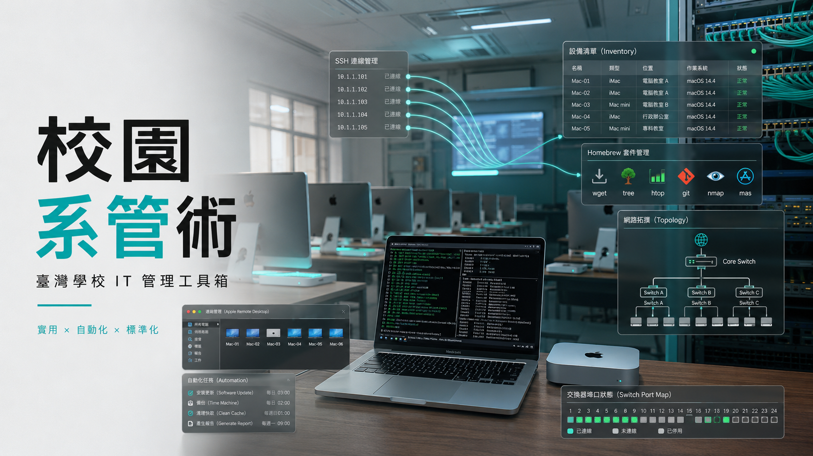

# 🏫 School IT Toolkit v2 ｜ AI 系管師工具包

<p align="center">
  
</p>

> **給全臺灣辛苦的一人資訊組長**：讓 AI（包含可以在學校本機跑的免費小模型）成為你最得力的「系管助手」——幫你查設備在哪、找電腦插在交換器哪個埠、找出哪台 AP 離線、陪你批次維護教室電腦，並在停電後從容分階段驗收。
> **先唯讀、後變更，跑腿查修交給它，關鍵把關永遠由你親自點頭。**
>
> *Let an AI assistant — even a small local model — safely help run a school network: read-only first, changes only with explicit human approval.*

[](LICENSE)

> 🌐 **專屬網站：[polik18.github.io/school-it-toolkit](https://polik18.github.io/school-it-toolkit/)**　｜　📖 **[好讀版教學：功能介紹與一步一步上手](https://polik18.github.io/school-it-toolkit/blog/ai-sysadmin-tutorial.html)**

---

## ✨ v2 有什麼新東西 / What's new in v2

在 v1 中，這是一組貼心好用的「Mac 機房 × 交換器盤點」日常腳本；而在 v2，我們把**「如何讓 AI 安全參與校園維運、減輕老師負擔」**的實戰方法，淬鍊成一套**任何學校都能輕鬆套用的開源框架**：

| v2 核心亮點 | 生活化的貼心設計 |
| :--- | :--- |
| 🧭 **專屬安全指令（單一 CLI 門面 `sitk`）** | 給 AI 一張乾淨受控的動詞選單，只需呼叫 `sitk <領域> <動詞> --json` 讀取狀態，不再讓它在黑漆漆的終端機裡隨意拼湊危險的 shell 指令。 |
| 📒 **設備數位點名簿（白名單機制）** | 空間與設備完全以學校的 CSV 清冊為準；名冊上查不到就誠實停下，絕不給 AI 任何發揮幻想、腦補幽靈設備的機會。 |
| 🛡️ **雙重安全煞車（Fail-Closed 防護網）** | 預設永遠是安全無害的演練預覽（`DRY_RUN`）；變更動作必須你親自授權 `--apply`；遇到防火牆等高風險設定，還得指名道姓雙重覆核；超出管理網段一律拒絕。 |
| 🔁 **任務進度書籤（狀態機引擎）** | 寒暑假全校電腦大保養，中途被叫去開會或處理突發狀況也別慌，隨時回來按一下就能無痛「接關」繼續，絕不漏做任何一台。 |
| 🔌 **跨廠牌全能轉接（Adapters）** | 用同一套溫和好懂的動詞，統整各家不同指令：交換器（Dell / Cisco / Aruba / HPE 等唯讀檢視）、FortiGate 無線、Linux iptables 防火牆、BIND9 + DHCP、教室 Mac 與網路電話；每一類都附模擬版供放心演練。 |
| 🧠 **一鍵生成 AI 專屬技能手冊** | 執行 `setup/init.py` 即可自動產出掛載到 Claude Code、Codex 或校內本地小模型的技能檔，內建十條校園維運核心天條。 |
| 🔐 **鑰匙鎖在保險箱（密碼隔離）** | 底層程式自動由 macOS Keychain 或加密檔案安全取用憑證，AI 與提問對話窗完全接觸不到密碼明文；設備抓回的外部文字一律標記為不可信資料，徹底杜絕提示注入。 |

> 💡 **舊版夥伴請安心**：v1 累積的所有優秀工具（`tools/`、`setup/init-wizard.py`）**通通完整保留**，完全相容；升級請參閱 [v1 → v2 遷移指南](docs/zh-TW/migrate-v1-to-v2.md)。

---

## 🚀 五分鐘無痛試玩（不必連設備，在自己筆電放心按）

這套工具包最體貼的地方，就是**只要電腦有 Python 3.11 以上即可**（Mac 系統多半已內建）。純標準庫打造，**完全不用執行 `pip install`**，不會污染你的系統環境。

不用接真實設備、不用怕按壞，五分鐘在自己電腦上感受有人幫你跑腿的輕鬆：

```bash
git clone https://github.com/polik18/school-it-toolkit.git
cd school-it-toolkit
python3 setup/init.py --example          # 建立虛擬的「示範國小」站點（全模擬轉接器，放手大膽玩）

bin/sitk doctor                          # 系統自我全身健康檢查
bin/sitk room 三年六班                    # 用老師的日常說法，一秒查出班級空間與所有設備
bin/sitk --json wifi aps --offline        # 快速過濾出全校正在離線的 AP
bin/sitk wifi reboot 306班                # 預設只回傳 DRY_RUN 預覽，絕不擅自動手
bin/sitk firewall apply --apply           # 系統主動踩煞車：高風險核心變更需指名 --confirm
bin/sitk info 火星教室                    # 回傳 UNKNOWN_ASSET：點名簿沒有就不猜，安全第一
```

- 想正式導入自己的學校？請看 [新手快速開始指南](docs/zh-TW/quickstart.md)
- 想先盤點校內有哪些資源適合納管？請看 [建議建立的可管理資源清冊](docs/zh-TW/recommendations.md)
- 想深入了解讓小模型也能穩健維運的原理？請看 [架構設計說明](docs/zh-TW/architecture.md)

---

## 🧩 目錄結構與架構 / Layout

```
sitk/                核心邏輯（站點組態、白名單點名簿、安全守門、密碼保管箱、狀態機、稽核足跡）與設備轉接器
bin/sitk             單一 CLI 操作門面
skills/templates/    AI 專屬技能樣板（sitk-sysadmin 總控 / network 網路 / endpoints 電腦 / voip 電話 / power 停復電）
setup/init.py        v2 站點初始化精靈：互動引導建立 site/ 目錄與專屬技能
examples/demo-school 示範國小虛擬演練資料（採用 RFC 5737 專用文件網段）
schemas/             設備清冊欄位規範與 JSON 輸出合約
tools/ lib/ setup/   v1 實用工具（完整保留）
docs/zh-TW docs/en   繁體中文與英文完整技術文件
```

> 🔒 **資安保護**：你學校的真實資產資料一律存放在獨立的 `site/` 目錄中（已被 `.gitignore` 嚴密隔離），包括設定檔、設備清冊、密碼環境檔、生成的技能、備份與日誌，**絕對不會意外提交到 Git 或推上網路**。

---

## 🔭 第一線日常實戰：「老師說班上電腦不能上網」

這是每位資訊老師每週最常碰到的求助。過去要在好幾棟樓與機房之間來回奔走，現在只要讓工具包依序幫你跑完四個標準動作：

```bash
bin/sitk --json info 三年六班電腦            # 1. 翻閱點名簿：確認電腦的 IP、MAC 與位置
bin/sitk --json endpoint status pc-a306      # 2. 檢測基本連線：確認 ping 或 SSH 能否連通
bin/sitk --json switch find-mac <MAC>        # 3. 實體循線：一鍵查出它到底插在哪台交換器的哪一個埠
bin/sitk --json dhcp search <MAC>            # 4. 門牌發放：確認 DHCP 伺服器有沒有正常分配 IP
```

先將問題範圍縮小到單一節點，再從容動手排除。

> 💡 **第一線老手經驗談**：如果一進教室發現**整排相鄰座號的電腦集體斷線**，先看看是不是掃具倒下撞到了延長線開關，或者是學生的球鞋踢鬆了地板插座，先查實體電源，千萬別急著登入交換器改設定！完整圖文教學可參考 [`docs/zh-TW/network-discovery.md`](docs/zh-TW/network-discovery.md#3-實戰教學老師說電腦不能上網end-to-end)。

---

## 🎯 這套工具適合誰 / Who is this for

- **國中小與高中資訊組長／網管同仁**：一人身兼多職、常常在教學大樓跑得滿頭大汗，渴望有 AI 助手幫忙跑腿分擔，但**絕不能接受 AI 魯莽亂改設定**。
- **重視資安與隱私的校園環境**：想在校內伺服器跑**本地離線小模型**（如 Ollama、LM Studio、oMLX），完全不花額外經費、不把任何校內資料傳上雲端。
- **校內設備廠牌多元的管理者**：即使清單上沒有貴校的廠牌也沒關係，架構非常彈性，依照 [轉接器設定與擴充指南](docs/zh-TW/adapters.md) 加上幾行指令設定即可套用。
- 您對校內受管設備擁有合法合規的管理授權。

---

## 🔐 資安與防護哲學 / Security first

- **真實機敏資料永不上雲**：`site/`、`*.env`、金鑰、點名清冊、備份與執行日誌，全部被預設 `.gitignore` 嚴格阻擋；版本庫中只有樣板與虛構的示範資料。
- **預設安全煞車**：唯讀查詢優先、明確下達 `--apply` 才動手、高風險動作需指名 `--confirm` 覆核、超出管理網段直接拒絕、防火牆內建失敗自動回滾的死人開關、所有操作完整留存稽核足跡。
- **雲端模型使用須知**：請勿將學校的真實設備清冊、設定備份或除錯日誌隨意貼入外部雲端 AI 對話框。
- **分享交流安全守則**：若要與他校同仁交流，請直接分享專案網址或乾淨版本；若要分享本地資料夾，請使用乾淨打包指令：`git archive --format=zip -o clean.zip HEAD`，避免將帶有本機憑證的 `site/` 一併打包外流。

完整威脅模型與資安建議請參閱 [docs/zh-TW/security.md](docs/zh-TW/security.md)；若發現潛在弱點歡迎參閱 [SECURITY.md](SECURITY.md) 進行通報。

---

## ⚖️ 授權條款 / License

本專案採用 [MIT 授權條款](LICENSE) — 竭誠歡迎全臺灣與世界各地的學校夥伴自由使用、修改、擴充與交流散播。

---

## 🙏 致謝與心聲 / Acknowledgements

由臺灣基層**小黃老師**結合實際校園系統管理日常整理開源。我們深知一人掌管全校網路與電腦的辛苦與孤單，希望能把無數次摸索、踩坑的實戰經驗與「讓 AI 成為懂事副手」的維運方法回饋給教育現場的每一位夥伴。

*Crafted with heart by a Taiwanese elementary-school IT teacher — sharing real-world battlefield lessons and safe AI-assisted operations practices back to the education community.*

---

<sub>

**關鍵字 / Keywords**：AI 系管師、AI 校園網管、學校 IT 管理、校園資訊組長工具、小模型維運、本地 LLM 網管、Mac 機房批量管理、電腦教室管理、Apple Remote Desktop 批次納管、交換器 MAC 找埠、FortiAP 離線查詢、防火牆死人開關、停電復電驗收、網路電話盤點、IT 交接文件。
AI sysadmin for schools · SLM-friendly CLI facade · fail-closed network automation · school network management · macOS fleet management without MDM · switch MAC lookup · FortiAP monitoring · firewall deadman switch · power outage recovery checklist · K-12 IT.

</sub>
