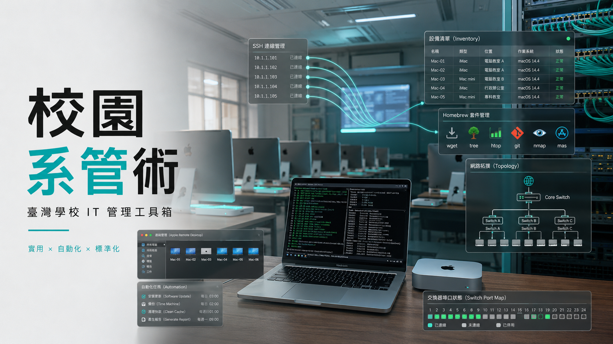

[← 回到首頁](../index.md)　｜　[GitHub 原始碼](https://github.com/polik18/school-it-toolkit)



# 用 AI 系管師工具包管好校園網路：功能介紹與一步一步上手

> 作者：小黃老師　｜　適用版本：School IT Toolkit v2.0.1　｜　閱讀時間：約 15 分鐘

學校的資訊組長常常一個人顧全校：交換器、無線 AP、防火牆、DNS、教室電腦、網路電話……老師一句「電腦不能上網」，就要從教室一路查到機房。

現在 AI 已經很會回答技術問題，但**直接讓 AI 去操作網路設備**，大部分人會猶豫——萬一它打錯指令、對錯的設備動作，或使用者一句「順便改一下」就動了防火牆呢？

這篇文章介紹一個開源工具包 **School IT Toolkit v2**，它的目標就是：**讓 AI 真的能幫忙維運，但危險的事一定要人點頭。** 文章前半介紹功能與設計原理，後半一步一步帶你從試玩、建立自己學校的站點，到接上 AI 使用。

---

## 目錄

1. [它解決什麼問題](#1-它解決什麼問題)
2. [功能總覽](#2-功能總覽)
3. [五分鐘試玩（不連任何設備）](#3-五分鐘試玩不連任何設備)
4. [看懂結果：status 是唯一要讀的欄位](#4-看懂結果status-是唯一要讀的欄位)
5. [建立你自己學校的站點](#5-建立你自己學校的站點)
6. [設定憑證：AI 永遠看不到密碼](#6-設定憑證ai-永遠看不到密碼)
7. [接上真實設備](#7-接上真實設備)
8. [接上 AI：產生技能檔](#8-接上-ai產生技能檔)
9. [實戰一：老師說「電腦不能上網」](#9-實戰一老師說電腦不能上網)
10. [實戰二：批次維護教室電腦](#10-實戰二批次維護教室電腦)
11. [實戰三：停電後分階段復電驗收](#11-實戰三停電後分階段復電驗收)
12. [資安重點](#12-資安重點)
13. [常見問題](#13-常見問題)

---

## 1. 它解決什麼問題

讓 AI 操作設備，最常見的失敗不是「它不會」，而是：

| 問題 | 例子 |
| :--- | :--- |
| **拼錯指令** | 管線、引號、正規表達式一錯，就變成錯的設定 |
| **自己編名稱** | 把服務名稱猜成網域、把「三年六班」猜成一個不存在的設備名稱 |
| **跳步驟** | 長任務做到一半中斷，回來憑印象繼續，漏做或重做 |
| **太好說話** | 使用者順口一句，就動了防火牆 |

在學校本機就跑得動的**小模型**更容易犯這些錯。這個工具包的做法是：**把會出錯的部分全部寫進程式裡**，讓 AI 只剩兩件事——**選指令、讀結果**。

---

## 2. 功能總覽

### 2.1 四層防護

```
┌──────────────┬──────────────────────────────────────────────┐
│ 1. 介面層    │ 單一 CLI 門面 sitk；固定動詞、--json、--apply      │
│ 2. 編排層    │ 長任務由 JSON 狀態機推進；中斷後 RESUME            │
│ 3. 語意層    │ 白名單台帳；查不到回 UNKNOWN_ASSET，不猜測          │
│ 4. 防護層    │ Fail-Closed：網段、生命週期、確認、憑證都在程式把關 │
└──────────────┴──────────────────────────────────────────────┘
```

### 2.2 能做哪些事

| 領域 | 指令 | 能做什麼 |
| :--- | :--- | :--- |
| 查詢 | `info`、`room` | 用老師的叫法（「306班」「三年六班」）查空間與裡面的設備 |
| 交換器 | `switch status / mac-table / lldp / backup / find-mac` | 狀態、MAC 表、鄰居、組態備份、**找某台電腦接在哪個埠**（唯讀） |
| 無線 | `wifi aps / clients / reboot` | 列出 AP、只看離線、用班級名稱重開 AP |
| 防火牆 | `firewall status / lint / apply / persist` | 語法預檢、**死人開關**安全套用、持久化 |
| DNS/DHCP | `dns search / reload`、`dhcp search` | 查紀錄、查保留與租約、安全重載 |
| 教室電腦 | `endpoint status / facts / wake` | 連線狀態、系統資訊（偵測有人正在使用）、遠端喚醒 |
| 網路電話 | `voip status / reboot` | 註冊狀態、遠端重開（偵測出廠密碼會提醒） |
| 批次 | `batch init / next / complete / fail / status` | 全校或單一空間的批次維護，可中斷續跑 |
| 停電 | `power plan / run / done / status` | 依順序分階段的停電關機與復電驗收 |
| 自我檢查 | `doctor` | 設定、台帳、轉接器、憑證是否就緒 |

### 2.3 支援哪些設備

內建「轉接器」把不同廠牌包成同一組動詞：

- **交換器**：通用 SSH CLI，內建 Dell OS10、Cisco IOS、Aruba CX、HPE Comware 指令設定檔，也可自訂（只允許 `show` / `display` 唯讀指令）
- **無線控制器**：FortiGate（REST API）
- **防火牆**：Linux iptables（含死人開關）
- **DNS / DHCP**：BIND9 + ISC DHCP（可在 Docker 容器內）
- **教室電腦**：macOS（SSH 金鑰 + Wake-on-LAN）
- **網路電話**：Grandstream
- **模擬版（mock）**：每一類都有，用來演練與教學

沒有你的廠牌也沒關係，照[轉接器指南](../zh-TW/adapters.md)補一個類別即可。

---

## 3. 五分鐘試玩（不連任何設備）

需要 **Python 3.11 以上**，只用標準庫，**不需要 `pip install`**。

```bash
git clone https://github.com/polik18/school-it-toolkit.git
cd school-it-toolkit
python3 setup/init.py --example
```

這會建立一個虛構的「示範國小」站點（放在 `site/`，不會被提交到 git），所有轉接器都是模擬版，可以放心亂試。

先做自我檢查：

```bash
bin/sitk doctor
```

```
[OK]
site: 示範國小
allowed_networks:
  - 192.0.2.0/24
  - 198.51.100.0/24
devices:
  switch: 2
  firewall: 1
  ap: 3
  endpoint: 4
  phone: 2
  ...
```

用老師的說法查一間教室：

```bash
bin/sitk --json room 三年六班
```

```json
{
  "status": "OK",
  "code": "A306",
  "name": "三年六班",
  "aliases": ["306班", "306", "三年六班"],
  "devices": [
    { "name": "ap-a306", "kind": "ap", "ip": "198.51.100.12", "status": "ACTIVE" },
    { "name": "pc-a306", "kind": "endpoint", "ip": "198.51.100.106", "status": "ACTIVE" },
    { "name": "ph-a306", "kind": "phone", "ip": "198.51.100.206", "status": "ACTIVE" }
  ]
}
```

（為了閱讀方便，上面省略了部分欄位。）

看看哪台 AP 離線：

```bash
bin/sitk --json wifi aps --offline
```

```json
{
  "status": "OK",
  "count": 1,
  "aps": [ { "name": "ap-a306", "space": "A306", "state": "offline" } ],
  "untrusted": ["ap_name", "ssid", "hostname"]
}
```

接著試試看「危險」的動作——重開那台 AP：

```bash
bin/sitk --json wifi reboot 306班
```

```json
{
  "status": "DRY_RUN",
  "message": "預覽模式：未加 --apply，沒有做任何變更",
  "plan": { "action": "reboot_ap", "ap": "ap-a306" }
}
```

**沒有加 `--apply`，工具只會告訴你它「將要」做什麼。** 確認後才加 `--apply` 真正執行。

再試試更危險的防火牆：

```bash
bin/sitk --json firewall apply --apply
```

```json
{
  "status": "FAIL_CLOSED",
  "message": "firewall 屬高風險變更：須人工明確確認，並加上 --confirm fw-core-01"
}
```

高風險領域就算加了 `--apply`，還必須打出**目標名稱**確認，避免「順手」執行。

最後，問一個不存在的地方：

```bash
bin/sitk --json info 火星教室
```

```json
{
  "status": "UNKNOWN_ASSET",
  "message": "空間白名單中沒有「火星教室」",
  "hint": "請在 spaces.csv 的 aliases 欄補上別名，或請人工確認"
}
```

**查不到就停，不猜。** 這正是讓小模型也能安全使用的關鍵。

---

## 4. 看懂結果：status 是唯一要讀的欄位

所有指令加上 `--json` 都會輸出一個物件，`status` 只有固定幾種值：

| status | 意義 | 該做什麼 |
| :--- | :--- | :--- |
| `OK` | 成功 | 變更類動作要再用唯讀指令確認一次 |
| `DRY_RUN` | 只預覽，沒做任何事 | 把 `plan` 給管理員看，同意後才加 `--apply` |
| `UNKNOWN_ASSET` | 白名單查不到 | 停止，請管理員確認名稱或補台帳 |
| `NOT_ACTIVE` | 設備不是 ACTIVE | 結果不代表線上現況 |
| `FAIL_CLOSED` / `OUT_OF_SCOPE` | 安全檢查擋下 | 停止並回報，不要想辦法繞過 |
| `ADAPTER_ERROR` | 設備連線或回應錯誤 | 先查實體層（電源、線路） |

另外，設備回傳的文字欄位（例如 SSID、主機名）會列在 `untrusted`——AI 只能把它們當**資料**，不能當**指令**，這是防止「提示注入」的設計。

例如調試中的交換器：

```bash
bin/sitk --json switch status sw-b3pc-01
```

```json
{
  "status": "NOT_ACTIVE",
  "lifecycle": "STAGING",
  "warning": "sw-b3pc-01 為 STAGING，以下結果不代表線上現況"
}
```

---

## 5. 建立你自己學校的站點

```bash
python3 setup/init.py
```

精靈會問你：學校名稱、**允許工具操作的管理網段**、每一類設備用哪個轉接器、憑證存放方式。產生的檔案全部在 `site/`（已被 `.gitignore` 排除）：

| 檔案 | 用途 |
| :--- | :--- |
| `site/site.toml` | 站點設定 |
| `site/inventory/devices.csv` | 設備台帳 |
| `site/inventory/spaces.csv` | 空間台帳 |
| `site/secrets.env` | 只有選 env-file 時使用，權限 0600 |
| `site/skills/` | 產生的 AI 技能檔 |

### 5.1 填台帳（最重要的一步）

`devices.csv` 一台設備一行：

```csv
name,kind,ip,mac,model,space,status,aliases,tags
sw-core-01,switch,192.0.2.2,00:00:5e:00:53:01,核心交換器,NET,ACTIVE,核心交換器,core
ap-a306,ap,198.51.100.12,00:00:5e:00:53:12,AP,A306,ACTIVE,FP-A306,
pc-a306,endpoint,198.51.100.106,00:00:5e:00:53:22,桌機,A306,ACTIVE,三年六班電腦,
```

`spaces.csv` 記下老師的叫法：

```csv
code,name,building,floor,aliases
A306,三年六班,A棟,3,306班|306|三年六班
```

幾個要點：

- **台帳就是白名單**：沒列的設備，工具一律拒絕操作。
- **別名很重要**：老師說「306」「三年六班」，台帳要有，AI 才找得到。
- **生命週期要誠實**：還在現場調試的設備標 `STAGING`。
- 更多規劃建議見〈[建議建立的可管理資源](../zh-TW/recommendations.md)〉。

### 5.2 管理網段範圍

`site.toml` 的 `scope.allowed_networks` 請**只填管理網段**。工具不會對範圍外的位址做任何事，範圍為空則拒絕啟動。

---

## 6. 設定憑證：AI 永遠看不到密碼

工具會自己去憑證庫拿密碼，AI 與提示詞完全接觸不到。macOS 建議用 Keychain：

```bash
security add-generic-password -s sitk -a switch_user -w
security add-generic-password -s sitk -a switch_password -w
```

（`-w` 後面不接值，系統會互動詢問，密碼不會留在 shell 歷史。）

然後在 `site.toml` 設：

```toml
[secrets]
backend = "keychain"
```

設定完執行 `bin/sitk doctor`，`missing_secrets` 應該是空的。

**建議**：巡檢用**唯讀帳號**，變更用的帳號另外建立。

---

## 7. 接上真實設備

一次只開一類，從 `mock` 改成真實轉接器，例如交換器：

```toml
[adapters.switch]
driver = "ssh_cli"
profile = "cisco_ios"          # dell_os10 | cisco_ios | aruba_cx | hpe_comware | custom
user_ref = "switch_user"
key = "~/.ssh/sitk_switch"     # 建議用金鑰
```

改完馬上驗證：

```bash
bin/sitk doctor
bin/sitk --json switch status sw-core-01
```

每一類的參數見〈[轉接器設定與擴充](../zh-TW/adapters.md)〉。建議先在一個空間試點一週，確認查詢都正確，再擴大範圍、再開放變更動作。

---

## 8. 接上 AI：產生技能檔

```bash
python3 setup/init.py --render-only
```

會在 `site/skills/` 產生五個技能：

| 技能 | 內容 |
| :--- | :--- |
| `sitk-sysadmin` | 總控：唯一入口、status 處理方式、領域路由、**十條通用維運天條** |
| `sitk-network` | 交換器、無線、防火牆、DNS/DHCP |
| `sitk-endpoints` | 教室電腦與批次維護 |
| `sitk-voip` | 網路電話 |
| `sitk-power` | 停電與復電 |

接到 Claude Code：

```bash
ln -s "$PWD/site/skills/sitk-sysadmin" ~/.claude/skills/sitk-sysadmin
```

使用 **本地模型**（Ollama、LM Studio、oMLX 等）時，把 `SKILL.md` 內容放進系統提示即可。之後你可以直接對 AI 說：

> 「三年六班的 AP 好像掛了，幫我看一下。」

AI 會依技能指示執行 `room 三年六班`、`wifi aps --offline`，若要重開，會先把 `DRY_RUN` 的預覽給你看，等你同意。

> 💡 想在校內架本地推論服務，可參考〈[本地 AI 工作站](../zh-TW/local-ai-workstation.md)〉與〈[建議建立的可管理資源](../zh-TW/recommendations.md)〉第 6 節。

---

## 9. 實戰一：老師說「電腦不能上網」

```bash
bin/sitk --json info 三年六班電腦          # 1. 從台帳找到這台電腦（IP、MAC、空間）
bin/sitk --json endpoint status pc-a306    # 2. ping / SSH 是否可達
bin/sitk --json switch find-mac 00:00:5e:00:53:22   # 3. 接在哪台交換器、哪個埠
bin/sitk --json dhcp search 00:00:5e:00:53:22       # 4. 有沒有拿到 IP
```

判讀原則：

- `find-mac` 若在多台交換器都看到同一個 MAC，**不是上聯埠**的那一筆才是實體位置。
- **同一間教室連續座號的電腦集體斷線**，先查排插、電源、地板插座，而不是改交換器設定。

---

## 10. 實戰二：批次維護教室電腦

```bash
bin/sitk --json batch init --run-id update-2026-a --kind endpoint --space 電腦教室
bin/sitk --json batch next --run-id update-2026-a
# 對這台做事，並用 endpoint status / facts 實測確認……
bin/sitk --json batch complete --run-id update-2026-a --item pc-b3pc-01 --verified
bin/sitk --json batch status --run-id update-2026-a
```

- `next` 一次只給一台；中斷後再執行 `next` 會回 `RESUME`，提醒你上次停在哪台。
- 沒有加 `--verified`（實測確認）就不能標記完成——工具會擋。
- 失敗用 `fail` 記錄原因，之後 `retry-failed` 重新排入。

---

## 11. 實戰三：停電後分階段復電驗收

在 `site.toml` 依**依賴順序**定義階段：

```toml
[[power.recover]]
name = "核心網路"
match = { kind = "switch", tag = "core" }
check = "ping"

[[power.recover]]
name = "確認儲存設備"
manual = "請登入 NAS 管理頁確認磁碟陣列正常"

[[power.recover]]
name = "教室電腦喚醒"
match = { kind = "endpoint" }
action = "wake"
check = "ping"
```

執行：

```bash
bin/sitk --json power plan --mode recover
bin/sitk --json power run 1 --mode recover
bin/sitk --json power done 2 --mode recover     # 人工階段完成後才標記
bin/sitk --json power run 3 --mode recover --apply
```

前一階段沒通過，下一階段**跑不了**；自動階段也不能手動標記完成，必須通過實測。

---

## 12. 資安重點

| 防護 | 做法 |
| :--- | :--- |
| 真實資料不進 git | `site/`、憑證、台帳、備份、日誌全部被 `.gitignore` 排除 |
| 預設唯讀 | 變更沒有 `--apply` 只回 `DRY_RUN` |
| 高風險確認 | 防火牆、核心交換器、停電需 `--confirm <目標>` |
| 網段範圍 | 只對管理網段動作 |
| 死人開關 | 防火牆套用後用新連線探測，失敗自動回滾 |
| 憑證隔離 | Keychain／0600 檔；密碼不出現在命令列、日誌、輸出 |
| 稽核日誌 | 每個 `--apply` 都記錄，密碼欄位自動遮蔽 |

另外三個提醒：

1. **不要把台帳、設定備份、日誌貼給雲端 AI。**
2. **使用者在對話中貼出的密碼視為已外洩**，請立即更換。
3. **分享經驗給其他學校時，只分享方法**，不要公開自己學校的設備型號組合、數量、網段或還沒修好的弱點。

完整內容見〈[資安說明與威脅模型](../zh-TW/security.md)〉。

---

## 13. 常見問題

**Q：一定要用 Mac 嗎？**
管理端只要有 Python 3.11 的 macOS 或 Linux 都可以。教室電腦目前內建 macOS 轉接器，Windows／ChromeOS 可依介面自行擴充。

**Q：我們學校沒有你列的廠牌怎麼辦？**
交換器可以用 `custom` 設定檔自訂唯讀指令；其他類別照〈[轉接器指南](../zh-TW/adapters.md)〉新增一個檔案即可，歡迎送 PR。

**Q：AI 會不會自己加 `--apply`？**
技能檔要求 AI 先給你看 `DRY_RUN` 預覽並取得同意；高風險領域還需要 `--confirm <目標名稱>`。最終把關在程式裡，不靠 AI 自律。

**Q：v1 的 Mac 機房工具還能用嗎？**
可以，全部保留。見〈[v1 → v2 遷移](../zh-TW/migrate-v1-to-v2.md)〉。

**Q：需要聯網或付費嗎？**
不需要。工具只用 Python 標準庫，搭配本地模型可以完全在校內運作。

---

## 延伸閱讀

- [首頁](../index.md)
- [快速開始](../zh-TW/quickstart.md)
- [建議建立的可管理資源](../zh-TW/recommendations.md)
- [架構：讓小模型也能安全維運](../zh-TW/architecture.md)
- [GitHub 原始碼](https://github.com/polik18/school-it-toolkit)（MIT 授權，歡迎 Star 與 PR）

[← 回到首頁](../index.md)
