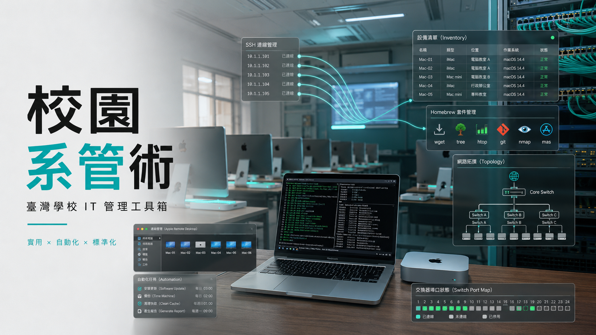

## 給全臺灣辛苦的一人資訊組長：讓 AI 成為勤快懂事的系管副手

**School IT Toolkit v2** 把「讓 AI 安全參與校園維運、減輕老師負擔」的方法，整理成一套任何學校都能輕鬆套用的開源框架：幫你查設備在哪、找電腦插在交換器哪個埠、找出哪台 AP 離線、陪你批次維護教室電腦，並在停電後從容分階段驗收——**先唯讀、後變更，查不到就誠實停下，危險動作一定要你親自點頭**。

### 📖 從這裡開始

| | |
| :--- | :--- |
| 🧭 **[好讀版教學：用 AI 系管師工具包管好校園網路](blog/ai-sysadmin-tutorial.md)** | 功能介紹＋一步一步上手（推薦先讀，有溫度好上手） |
| 🏗️ [建議建立的可管理資源清冊](zh-TW/recommendations.md) | 導入前該先準備哪些資產清冊 |
| 🚀 [新手快速開始指南](zh-TW/quickstart.md) | 正式導入步驟 |
| 🧱 [架構設計：讓小模型也能安全維運](zh-TW/architecture.md) | 設計思維與安全合約 |
| 🔌 [轉接器設定與擴充指南](zh-TW/adapters.md) | 各廠牌設定與自訂轉接器 |
| 🔐 [資安說明與威脅模型](zh-TW/security.md) | 哪些資料不能外流、工具內建哪些防護機制 |
| 🔁 [v1 → v2 遷移指南](zh-TW/migrate-v1-to-v2.md) | 舊版夥伴無痛升級指南 |
| 🌏 [English guide](en/README.md) | Overview in English |

### ✨ 核心亮點

- **專屬安全指令（單一 CLI 門面 `sitk`）**：給 AI 乾淨受控的動詞選單，只需呼叫 `sitk <領域> <動詞> --json` 讀取狀態，不再讓它在黑漆漆的終端機隨意敲危險指令。
- **設備數位點名簿（白名單機制）**：空間與設備以學校的 CSV 清冊為準；名冊上查不到就誠實停下，絕不給 AI 腦補幽靈設備的機會。
- **雙重安全煞車（Fail-Closed 防護網）**：預設永遠是安全預覽；變更必須手動授權 `--apply`；高風險操作需指名 `--confirm` 覆核；超出管理網段一律拒絕；防火牆內建失敗自動回滾的死人開關。
- **任務進度書籤（狀態機長任務）**：暑假全校電腦大保養，中斷了隨時無痛「接關」繼續，沒有實測確認絕不允許打勾。
- **跨廠牌全能轉接**：交換器（Dell / Cisco / Aruba / HPE 等唯讀檢視）、無線控制器、Linux 防火牆、DNS/DHCP、教室 Mac 與網路電話，每一類皆附模擬版供放心演練。
- **一鍵生成 AI 專屬技能**：依貴校站點設定，一鍵產出 Claude Code、Codex 或本地小模型適用的專屬技能手冊。

### 💻 五分鐘無痛試玩（不必連設備，在自己筆電放心按）

```bash
git clone https://github.com/polik18/school-it-toolkit.git
cd school-it-toolkit
python3 setup/init.py --example
bin/sitk room 三年六班
```

原始碼與完整說明：**[GitHub：polik18/school-it-toolkit](https://github.com/polik18/school-it-toolkit)**　｜　授權：MIT　｜　作者：小黃老師

更多作者的教學與系統工具：**[Polik Projects](https://polik18.github.io/)**
